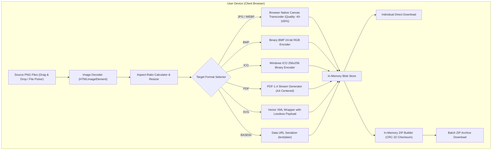

<div align="center">

# 🖼️ SPM PNG Studio™
### Enterprise-Grade, 100% Private In-Browser PNG Transformation Engine

[](LICENSE)
[](https://www.spmanchester.com)
[](docs/ARCHITECTURE.md)
[](CONTRIBUTING.md)
[](.github/workflows/ci.yml)
[](Dockerfile)

<p align="center">
  <strong>Convert, optimize, resize, and package PNG images into JPG, WebP, SVG, PDF, ICO, BMP, and Base64 entirely on the client device.</strong><br>
  <em>Zero server uploads · Zero telemetry · In-memory streaming ZIP generation · Dual architecture (Unified Studio + Standalone Micro-Tools).</em>
</p>

[**Explore Live Demo**](https://serviceprovidermanchester.github.io/SPM-PNG-Studio-/) · [**Architecture Docs**](docs/ARCHITECTURE.md) · [**API Guide**](docs/API.md) · [**Company Website**](https://www.spmanchester.com)

---

### *Built with ❤️ by SPManchester Private Limited*
**Lead Architect & Maintainer: Sayed Mudassar Akbar**  
Official Website: [www.spmanchester.com](https://www.spmanchester.com) · Contact: [info@spmanchester.com](mailto:info@spmanchester.com)

---

</div>

## 📌 Executive Overview

In enterprise environments, uploading proprietary graphics, brand assets, medical scans, or customer documents to public cloud-hosted image converters introduces grave **compliance vulnerabilities, data leakage risks, and bandwidth bottlenecks**.

**SPM PNG Studio™** solves this fundamentally by bringing high-throughput, multi-format transformation directly into the user's browser. Built on native HTML5 Canvas, Web Workers, and TypedArray memory manipulation, **no image data ever leaves the visitor's device**.

This software represents the dedication of **SPManchester Private Limited** to engineering robust, private, high-performance web solutions for organizations worldwide.

---

## ⚡ Key Architectural Advantages & Features

- 🔒 **100% Client-Side Privacy (Zero Telemetry):** All decoding, resizing, pixel remapping, and format encoding run in local browser RAM. No backend servers, external APIs, or data loggers.
- 🔄 **7+ Versatile Target Formats:**
  - **PNG → JPG:** Flatten transparency onto solid white with granular compression control.
  - **PNG → WebP:** Ultra-compact modern web compression with alpha transparency retention.
  - **PNG → SVG:** Encapsulate high-resolution pixels into responsive XML vector envelopes.
  - **PNG → PDF:** Clean, single-page PDF-1.4 generation centered on standard A4 margins.
  - **PNG → ICO:** 256×256 multi-resolution icon generation for apps and websites.
  - **PNG → BMP:** Pure 24-bit uncompressed RGB bitmap binary generation.
  - **PNG → Base64:** Instant Data URL string generator for CSS, HTML, and API integration.
- 📦 **In-Memory Streaming ZIP Bundling:** Built-in PKZIP 2.0 binary packer generates valid multi-file ZIP archives dynamically in browser `ArrayBuffers` with hardware-accelerated CRC-32 checksums.
- 📐 **Aspect-Ratio Preserved Resizing:** Choose from presets (100%, 75%, 50%, 25%) or specify custom pixel widths with automatic 36MP browser memory safety safeguards.
- 🚀 **Dual Architecture:**
  - **Unified Master Studio (`/index.html`):** All-in-one dynamic studio where users toggle formats on the fly.
  - **Modular Standalone Tools (`/converters/`):** 7 independent, zero-dependency micro-apps ready for isolated deployment.
- 📱 **Mobile & Desktop Responsive:** Polished dark-mode UI with accessibility (a11y) support and zero third-party framework overhead.

---

## 🏗️ Architecture & Processing Pipeline



---

## 💻 Tech Stack & Engineering Standards

| Layer | Technology | Engineering Role |
|---|---|---|
| **Core Engine** | Vanilla ES6+ JavaScript | Zero-dependency, lightweight, high-performance execution. |
| **Transcoding** | HTML5 Canvas 2D API | Hardware-accelerated pixel manipulation and rendering. |
| **Binary Encoders** | `ArrayBuffer`, `DataView`, `Uint8Array` | Direct byte manipulation for BMP, ICO, and PDF format compliance. |
| **Archive Packaging** | Custom In-Memory PKZIP 2.0 Engine | Tableless CRC-32 generation with zero external dependencies. |
| **UI & Styling** | Modern CSS3 (Grid, Flexbox, Gradients) | Dark-mode interface, responsive mobile-first layout. |
| **Containerization** | Docker (Alpine Nginx) | Enterprise on-premise and intranet container orchestration. |
| **Automation & CI** | GitHub Actions | Automated integrity checks, unit tests, and GitHub Pages CI/CD. |

---

## 📂 Repository Architecture

```text
png/
├── .github/
│   ├── ISSUE_TEMPLATE/
│   │   ├── bug_report.md             # Standardized bug reporting template
│   │   └── feature_request.md        # Feature enhancement request template
│   ├── workflows/
│   │   ├── ci.yml                    # Automated code validation & tests
│   │   └── deploy.yml                # Zero-config GitHub Pages deployment
│   └── PULL_REQUEST_TEMPLATE.md      # Enterprise PR checklist
├── converters/                       # Standalone modular micro-apps
│   ├── png-to-base64/                # Dedicated PNG to Base64 tool
│   ├── png-to-bmp/                   # Dedicated PNG to BMP tool
│   ├── png-to-ico/                   # Dedicated PNG to ICO tool
│   ├── png-to-jpg/                   # Dedicated PNG to JPG tool
│   ├── png-to-pdf/                   # Dedicated PNG to PDF tool
│   ├── png-to-svg/                   # Dedicated PNG to SVG tool
│   └── png-to-webp/                  # Dedicated PNG to WebP tool
├── docs/                             # In-depth architectural & deployment guides
│   ├── API.md                        # Programmatic SDK documentation
│   ├── ARCHITECTURE.md               # Technical breakdown & sequence diagrams
│   ├── DEPLOYMENT.md                 # Guides for Pages, Docker, Vercel, Nginx
│   └── SEO_AND_MARKETING_STRATEGY.md # GitHub SEO keywords & social strategy
├── src/                              # Reusable ES module source library
│   ├── core/
│   │   ├── bmp.js                    # 24-bit RGB bitmap encoder
│   │   ├── converter.js              # Universal transformation engine
│   │   ├── ico.js                    # Windows ICO resource encoder
│   │   ├── pdf.js                    # In-browser PDF-1.4 stream generator
│   │   ├── utils.js                  # Byte helpers & format utilities
│   │   └── zip.js                    # Pure JS PKZIP 2.0 binary builder
│   └── index.js                      # Main library entrypoint
├── tests/
│   └── converter.test.js             # Automated unit tests
├── .env.example                      # Environment configuration template
├── .gitignore                        # Git ignore rules
├── app.js                            # Master Studio JavaScript application
├── CODE_OF_CONDUCT.md                # Community Code of Conduct (v2.1)
├── CONTRIBUTING.md                    # Developer contribution guidelines
├── docker-compose.yml                # Docker Compose orchestration
├── Dockerfile                        # Multi-stage production Nginx container
├── favicon.svg                       # Branded SVG favicon
├── index.html                        # Master Studio Web Application
├── LICENSE                           # MIT License (SPManchester Private Limited)
├── Makefile                          # Developer automation commands
├── nginx.conf                        # Hardened Nginx configuration
├── package.json                      # NPM configuration & scripts
├── README.md                         # Master documentation (this file)
└── style.css                         # Master Studio styling
```

---

## 🚀 Quick Start & Installation

### Prerequisites
- Modern web browser (Chrome 90+, Edge 90+, Firefox 88+, Safari 14+)
- Node.js (v18+) *[Optional: only required for local dev server or tests]*

### 1. Run Locally (Zero Build Step)
```bash
# Clone the repository
git clone https://github.com/serviceprovidermanchester/SPM-PNG-Studio-.git
cd png

# Start local server (using npm or Python)
npm start
# OR: npx serve -l 3000 .
# OR: python -m http.server 3000
```
Open **`http://localhost:3000`** in your browser.

### 2. Run with Docker
```bash
# Build and run with Docker Compose
docker-compose up -d
```
Open **`http://localhost:8080`**.

### 3. Run Automated Tests
```bash
npm test
# OR: node tests/converter.test.js
```

---

## 💻 Programmatic Usage (SDK)

You can import and use the SPM conversion engine directly in your own applications:

```javascript
import { convertSingleImage, createZipBlob } from './src/index.js';

// Convert a single PNG file to WebP at 85% quality
const result = await convertSingleImage({
  file: myPngFile,
  targetFormat: 'WEBP',
  quality: 0.85,
  scaleOrCustom: 0.75 // 75% resolution
});

console.log(`Transformed: ${result.name} (${result.width}x${result.height})`);

// Package multiple results into an in-memory ZIP archive
const zipArchiveBlob = await createZipBlob([
  { name: result.name, blob: result.blob }
]);
```

---

## 🗺️ Roadmap & Future Enhancements

- [x] Master Studio with dynamic format switcher
- [x] 7 dedicated standalone converter tools
- [x] In-memory zero-dependency ZIP packaging
- [x] Aspect-ratio safe scaling & 36MP boundary checks
- [ ] WebAssembly-powered AVIF encoder
- [ ] Client-side batch watermark stamping
- [ ] Color profile preservation (ICC profile transfer)
- [ ] Offline PWA (Progressive Web App) service worker support

---

## 🤝 Contributing

We welcome contributions from the open-source community! Please review our [Contribution Guide](CONTRIBUTING.md) and [Code of Conduct](CODE_OF_CONDUCT.md).

1. Fork the Project
2. Create your Feature Branch (`git checkout -b feature/AmazingFeature`)
3. Commit your Changes (`git commit -m 'feat: Add AmazingFeature'`)
4. Push to the Branch (`git push origin feature/AmazingFeature`)
5. Open a Pull Request

---

## 🛡️ Security & Privacy

For security disclosures, please consult our [Security Policy](SECURITY.md).  
To report a potential vulnerability, email **[info@spmanchester.com](mailto:info@spmanchester.com)** with the subject `[SECURITY] SPM PNG Studio`.

---

## 🏢 About SPManchester Private Limited

**SPManchester Private Limited** is a premier software development and technology consulting firm dedicated to building high-impact, enterprise-grade digital products, scalable cloud architectures, and privacy-first software tools.

- 🌐 **Official Website:** [www.spmanchester.com](https://www.spmanchester.com)
- 👨‍💼 **Founder & Lead Architect:** Sayed Mudassar Akbar
- 📩 **General & Business Inquiries:** [info@spmanchester.com](mailto:info@spmanchester.com)
- 💼 **Services:** Full-Stack Custom Software Development, Cloud Infrastructure, AI Solutions, Enterprise Web Platforms.

---

## 📄 License & Attribution

This project is licensed under the **MIT License** — see the [LICENSE](LICENSE) file for details.

```text
Copyright (c) 2026 SPManchester Private Limited
Authored by: Sayed Mudassar Akbar
Website: https://www.spmanchester.com
Contact: info@spmanchester.com
```

<div align="center">
  <sub>Engineered with precision and integrity by SPManchester Private Limited.</sub>
</div>
