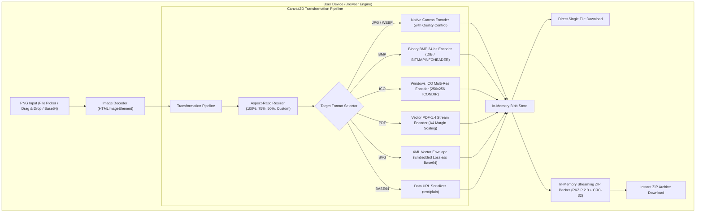
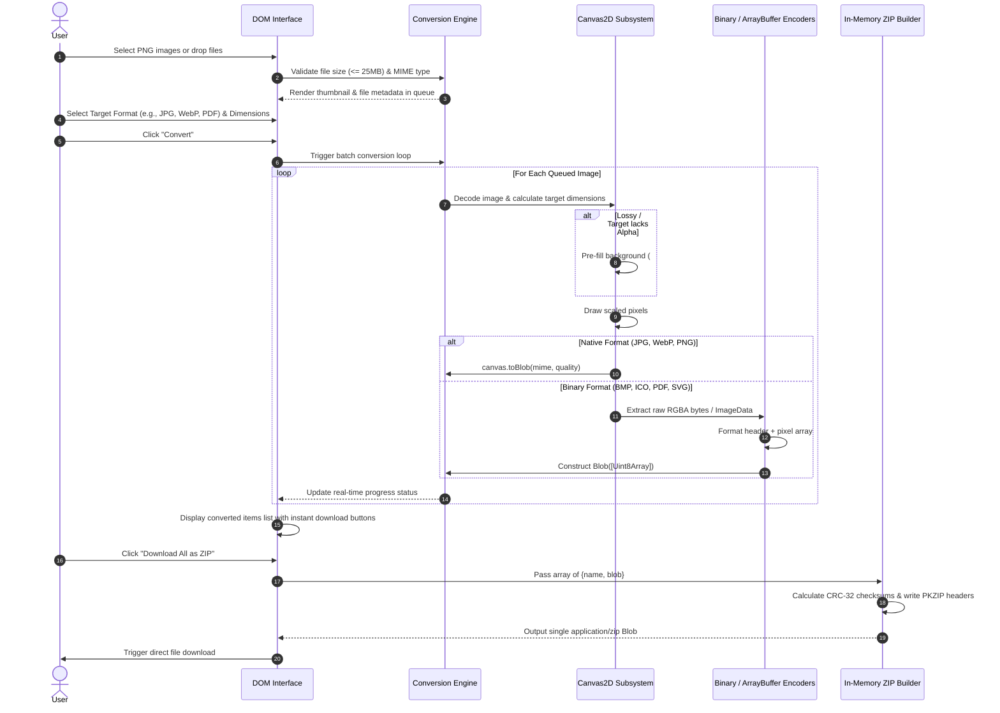

# Architecture & Technical Design

**SPM PNG Studio™** is an enterprise-grade, privacy-first image transformation suite architected by **SPManchester Private Limited** under the leadership of **Sayed Mudassar Akbar**.

---

## 1. Architectural Philosophy

Traditional web image converters upload user files to a cloud server, transcode them with headless utilities (e.g., ImageMagick, Sharp, FFmpeg), and return download links. This model introduces critical security risks:
- Risk of sensitive document interception in transit.
- Cold-storage data leakages on third-party servers.
- Latency incurred by high-bandwidth network payloads.

**SPM PNG Studio** eliminates server dependency entirely:
- **100% In-Browser Execution:** Transcoding runs in the client browser's JavaScript execution thread, leveraging Hardware-Accelerated Canvas2D APIs and TypedArrays.
- **Zero Telemetry / Zero Storage:** No file bytes, hashes, names, or metadata are ever transmitted across the network.
- **Microsecond Memory Allocation:** Blobs and Object URLs are systematically freed using `URL.revokeObjectURL()` to prevent memory spikes on mobile and desktop devices.

---

## 2. High-Level System Architecture

---

## 3. Data Processing Pipeline

---

## 4. Binary Encoders Specification

### 4.1. BMP 24-bit RGB Encoder (`src/core/bmp.js`)
- Standard 54-byte header consisting of `BITMAPFILEHEADER` (14 bytes) and `BITMAPINFOHEADER` (40 bytes).
- Row stride padded to 4-byte boundaries: `stride = w * 3 + (4 - (w * 3) % 4) % 4`.
- Pixel scanning inverted vertically (bottom-up scan) and mapped to `BGR` byte order.

### 4.2. Windows ICO Encoder (`src/core/ico.js`)
- Follows Windows Icon Resource format (`ICONDIR` + `ICONDIRENTRY`).
- Resizes source image into a 256x256 bounding box maintaining aspect ratio.
- Encapsulates lossless PNG data stream directly into the icon entry payload.

### 4.3. Pure In-Browser PDF-1.4 Generator (`src/core/pdf.js`)
- Embeds compressed DCT/JPEG byte streams into standard PDF indirect objects (`Catalog`, `Pages`, `Page`, `XObject`, `Contents`).
- Auto-scales high-resolution images within standard A4 print dimensions (`595.28 x 841.89 pt`) with balanced 28pt safety margins.

### 4.4. In-Memory ZIP Packer (`src/core/zip.js`)
- Pure JavaScript PKZIP 2.0 implementation without external dependencies like JSZip.
- Uses tableless hardware-friendly bitwise polynomial (`0xEDB88320`) for CRC-32 computation.
- Generates Local File Headers, Central Directory Records, and End of Central Directory (EOCD) records directly into a single contiguous `Blob`.

---

## 5. Security & Isolation

- **No Third-Party Analytics Trackers:** No tracking scripts or external telemetry libraries.
- **CSP Compliant:** Nginx container configurations include strict `Content-Security-Policy`, `X-Content-Type-Options: nosniff`, and `X-Frame-Options: SAMEORIGIN`.
- **Memory Safety:** Image data URLs created for thumbnails are immediately released via `URL.revokeObjectURL(url)` upon DOM render or queue clearance.

---

## 6. Corporate Attribution
- **Company:** SPManchester Private Limited
- **Website:** [www.spmanchester.com](https://www.spmanchester.com)
- **Lead Maintainer:** Sayed Mudassar Akbar
- **Contact:** [info@spmanchester.com](mailto:info@spmanchester.com)
